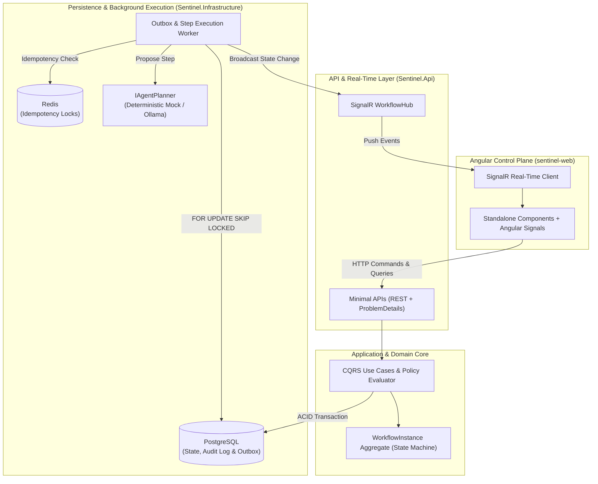
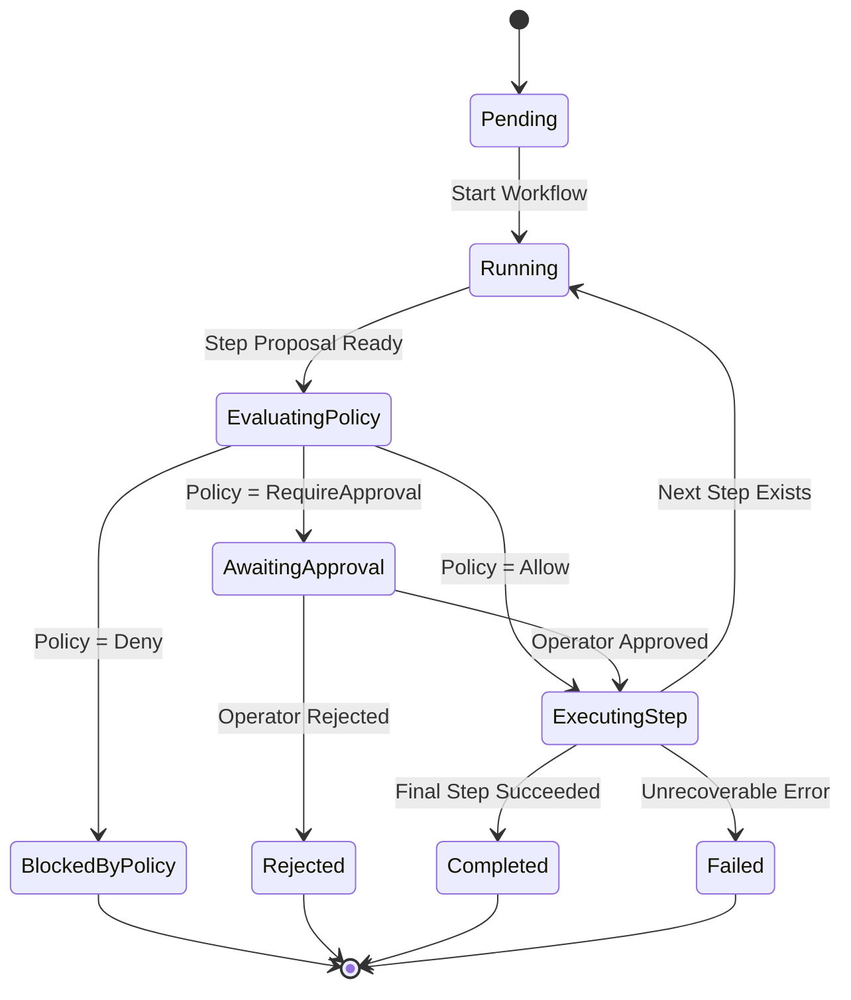

# 🛡️ Sentinel Orchestrator

[](https://dotnet.microsoft.com/)
[](https://angular.dev/)
[](https://www.postgresql.org/)
[](https://redis.io/)
[](LICENSE)

**Sentinel Orchestrator** is a local-first, governed workflow and agentic orchestration platform designed to execute operational automation safely. It bridges probabilistic AI reasoning (LLM/agent step proposals) with **deterministic policy guardrails, transactional durability, and Human-in-the-Loop (HITL) approval gates**.

> **Portfolio Showcase Focus:** Built as a self-contained monorepo demonstrating production-grade distributed systems patterns—Domain-Driven Design (DDD), Finite State Machines, Transactional Outbox, Optimistic Concurrency, Policy-as-Code, Real-Time SignalR/Angular Signals control planes, and OpenTelemetry distributed tracing—executable locally with zero cloud dependencies.

---

## 🎯 Core Problem & Architectural Philosophy

Allowing autonomous AI agents or automated scripts to directly mutate production infrastructure introduces severe reliability and compliance risks. **Sentinel Orchestrator** enforces a strict boundary between **proposal** and **execution**:

1. **Probabilistic Proposal:** Pluggable AI/Diagnostic steps analyze context and emit structured, schema-validated `ActionProposal` payloads—never holding infrastructure credentials or executing side effects directly.
2. **Deterministic Guardrails:** A pure C# **Policy Engine** evaluates every proposed action against deterministic risk rules (`Allow`, `RequireApproval`, or `Deny`).
3. **Human-in-the-Loop (HITL):** High-impact operations suspend execution cleanly in PostgreSQL and surface in real time in the Angular Control Plane for operator review, audit justification, and approval/rejection.
4. **Durable & Idempotent Execution:** State transitions and background execution commands are committed atomically via the **Transactional Outbox Pattern** and executed idempotently.

---

## 🏗️ System Architecture


## Workflow Lifecicle State Machine


## 🧠 Key Architectural Decisions (ADRs)
All major design trade-offs are documented under docs/adr/:

*   **ADR-001: Deterministic State Machine & Policy Guardrails** — Separating LLM/automated action proposals from deterministic state progression and policy evaluation.
*   **ADR-002: Transactional Outbox & Optimistic Concurrency** — Preventing dual-write inconsistencies and race conditions using PostgreSQL xmin concurrency tokens, FOR UPDATE SKIP LOCKED, and Redis idempotency keys.
*   **ADR-003: Reactive Control Plane with Angular Signals & SignalR** — Replacing polling with typed SignalR push events and fine-grained Angular signal() / computed() feature stores.
*   **ADR-004: Local-First Orchestration with .NET Aspire** — Single-command local startup with real PostgreSQL/Redis containers and correlated OpenTelemetry traces.

## 📂 Monorepo Structure

```
sentinel-orchestrator/
├── docs/
│   ├── PRD.md                       # Product Requirements & Showcase Scenarios
│   └── adr/                         # Architecture Decision Records (MADR format)
├── src/
│   ├── Sentinel.AppHost/            # .NET Aspire local orchestrator
│   ├── Sentinel.ServiceDefaults/    # OpenTelemetry, health checks & resilience defaults
│   ├── Sentinel.Domain/             # DDD Aggregates, State Machine & Policy Rules (0 dependencies)
│   ├── Sentinel.Application/        # CQRS Handlers, DTOs, Validators & Ports
│   ├── Sentinel.Infrastructure/     # EF Core (PostgreSQL), Outbox Worker, Redis & AI Adapters
│   ├── Sentinel.Api/                # Minimal APIs, SignalR Hubs & Automatic DB Seeding
│   └── sentinel-web/                # Angular SPA (Standalone Components, Signals, Tailwind)
├── tests/
│   ├── Sentinel.Domain.Tests/       # Pure unit tests for state transitions & policy rules
│   └── Sentinel.Integration.Tests/  # End-to-end persistence & concurrency tests (Testcontainers)
└── docker-compose.yml               # Alternative pure-Docker execution setup
```

## 🚀 Getting Started (Local Execution)

### Prerequisites
* .NET 10 SDK

* Node.js 26+ & pnpm

* Docker Desktop (or Podman) running locally

### Option 1: Run via .NET Aspire (Recommended)
Boots PostgreSQL, Redis, the .NET API, the Background Worker, the Angular SPA, and the Aspire OpenTelemetry Dashboard in one command:

```bash
dotnet run --project src/Sentinel.AppHost
```

Once started, open the Aspire Dashboard URL printed in the terminal to access:

* Angular Control Plane (sentinel-web): Live workflow dashboard, step inspector, and approval queue.
* Sentinel API (sentinel-api): OpenAPI / Scalar interactive API documentation.
* Distributed Traces & Metrics: End-to-end traceId correlation across HTTP requests, Outbox polling, and worker step execution.

### Option 2: Run via Docker Compose

```bash
docker compose up --build
```

* Control Plane UI: http://localhost:4200
* API & OpenAPI Docs: http://localhost:8080/scalar/v1

## 🧪 Built-In Showcase Scenarios
On first startup, the database is automatically seeded with three executable scenarios accessible from the UI's "Trigger Scenario" panel:

1. **Incident Triage & Diagnostics (`Auto-Allowed`):** AI/Diagnostic step analyzes service latency logs and proposes a read-only diagnostic report. Policy Engine evaluates risk as `Low` -> executes automatically end-to-end.
2. **Production Database Failover / Scaling (`Human-in-the-Loop`):** Planner proposes a high-impact production mutation. Policy Engine flags `RequiresApproval` -> workflow pauses in `AwaitingApproval` -> operator inspects the JSON payload and audit context in the UI and approves/rejects execution.
3. **Destructive Storage Deletion (`Blocked by Policy`):** Step proposes deleting a production volume. Policy Engine enforces hard guardrail -> workflow immediately transitions to `BlockedByPolicy` with full audit trail.

### ✅ Running Tests

```bash
# Run pure domain unit tests (state machine & policy guardrails)
dotnet test tests/Sentinel.Domain.Tests

# Run integration tests with real PostgreSQL & Redis via Testcontainers
dotnet test tests/Sentinel.Integration.Tests

# Run Angular unit tests
pnpm --dir src/sentinel-web test
```

## 👤 Author
**Rafael Paraná** — Platform Engineering Tech Lead & Full-Stack Architect

[LinkedIn](https://www.linkedin.com/in/rafaelparana/) • [GitHub](https://github.com/rparana)